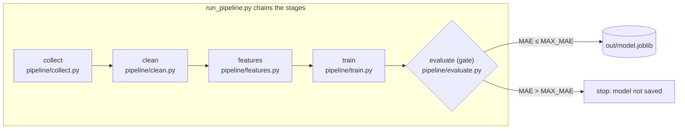
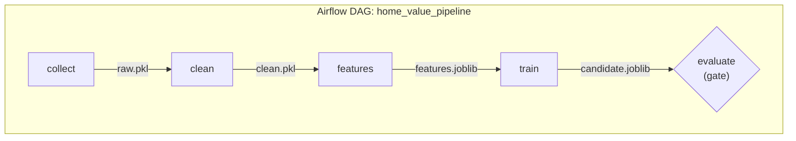

# Week 6 exercise: from script to automated pipeline

* CMKL 41-645 Software Engineering for AI-Enabled Systems
* Week 6: Automating the ML Pipeline

**Individual work · about 30 minutes**

## Learning outcomes

By the end of this exercise, you should be able to:

1. Split a monolithic training script into pipeline stages with clear inputs and outputs.
2. Make one stage robust to new data and prove the fix with a test.
3. Run the pipeline automatically on GitHub Actions, with an evaluation gate that stops a bad model.

## Scenario

You work for an online real-estate marketplace that shows a predicted fair value for every home. The model was built in a notebook and later pasted into `train_all.py`. It loads, cleans, encodes, trains, evaluates and saves in one file. Once a year someone runs it by hand.

The data team has just exported the first sales of 2026 (`data/sales_2026_q1.csv`). Your job is to turn the script into a pipeline that can take in new data and run without anyone watching.



### The data

Each row of a CSV file in `data/` is one home sale. The model learns to predict `price` from the other columns.

| Column | Meaning | Example |
|---|---|---|
| `sqft` | Living area in square feet | `2791` |
| `bedrooms` | Number of bedrooms (1–6) | `3` |
| `year_built` | Year the home was built (1950–2023) | `1968` |
| `region` | Area of the city: `Downtown`, `Hills`, `Outskirts`, `Riverside` or `Suburbs` | `Hills` |
| `sold_date` | Date of the sale | `2025-08-25` |
| `price` | Sale price in US dollars: what the model predicts | `645200` |

| File | What it is |
|---|---|
| `data/sales_2025.csv` | 500 sales from 2025. The data `train_all.py` was written for. |
| `data/sales_2026_q1.csv` | 150 sales from January–March 2026. It comes from a newer export of the sales system. You add it to the pipeline in Task 2. |

The data is synthetic (generated by `tools/make_data.py`), so the numbers are realistic but not real homes.

The model measures its error as **MAE** (mean absolute error): on average, how many dollars its predicted price is away from the real price on homes it did not train on. Lower is better.

### The files

| File | What it does | Do you edit it? |
|---|---|---|
| `train_all.py` | The original script: loads, cleans, encodes, trains, evaluates and saves, all in one file, in six numbered blocks. | No. You copy code **out of** it in Task 1. |
| `pipeline/collect.py` | Stage 1: reads the CSV files into one table. | **Task 1** |
| `pipeline/clean.py` | Stage 2: fixes types (such as dates) and removes rows that cannot be trusted. | **Task 1**, then **Task 2** |
| `pipeline/features.py` | Stage 3: turns a cleaned table into model inputs (`sqft`, `bedrooms`, `age`, one 0/1 column per region) and the target (`price`). | **Task 1** |
| `pipeline/train.py` | Stage 4: fits a decision-tree model. | **Task 1** |
| `pipeline/evaluate.py` | Stage 5: computes the MAE. It is the **evaluation gate**: if the MAE is above the limit, it stops the pipeline so a weak model is never saved. | No, already written. |
| `run_pipeline.py` | Runs the five stages in order and saves the model. Its top lines are the settings: which data files to use (`DATA_FILES`), the tree depth (`MAX_DEPTH`) and the gate's limit (`MAX_MAE`, in dollars). | Only the settings: **Task 2** and **Task 3** |
| `tests/test_clean.py` | Tests that say what the clean stage must guarantee, for the old **and** new data. Run them with `pytest`. | No. Make them pass. |
| `.github/workflows/pipeline.yml` | The GitHub Actions workflow: on every push, it installs the packages, runs `pytest`, then runs `run_pipeline.py`. | No. Read it in Task 3. |
| `REFLECTION.md` | Three short questions about what you did. | **Yes**, at the end. |

---

## 0. Setup (3 min)

1. **Fork** this repository (top right on GitHub) into your own account.
2. Get a terminal with Python. Pick **one** option:
   - **Your machine** (Python 3.9 or newer):
     ```bash
     git clone https://github.com/<your-username>/se4ai-pipeline.git
     cd se4ai-pipeline
     python3 -m venv .venv            # Windows: py -m venv .venv
     source .venv/bin/activate        # Windows: .venv\Scripts\activate
     python3 -m pip install --upgrade pip
     python3 -m pip install -r requirements.txt
     ```
   - **No Python installed?** On your fork, click **Code → Codespaces → Create codespace on main**. Everything is installed for you.
3. Check that the old script still works:
   ```bash
   python3 train_all.py
   ```
   You should see `MAE: $35,734` and `saved out/model.joblib`.

> **Stuck?**
> - **Windows:** type `python` wherever this README says `python3` (after you activate the virtual environment). Use `py` only to create it.
> - Always run commands from the repository root (the folder with this README).

---

## Task 1. Modularize (10 min)

`train_all.py` has six numbered blocks. Move blocks 1–4 into the matching stubs in `pipeline/`. Each stub has a docstring that says what it takes in and what it must return.

| Block in `train_all.py` | Goes into |
|---|---|
| 1. collect | `pipeline/collect.py` → `load_sales(paths)` |
| 2. clean | `pipeline/clean.py` → `clean_sales(df)` |
| 3. features | `pipeline/features.py` → `encode(df)` |
| 4. train (only the model lines) | `pipeline/train.py` → `train_model(X, y, max_depth)` |

`evaluate.py` and `run_pipeline.py` are already written.

When you are done:

```bash
python3 run_pipeline.py
```

It should print the **same MAE as the script** ($35,734) and save `out/model.joblib` and `out/metrics.json`.

> **Stuck?**
> - Each function gets its input as a parameter instead of using a global `df`, and must `return` its result.
> - `encode` returns two things: `return X, y`.
> - Don't copy the `USE_LOG_PRICE` experiment. Dead code paths are an antipattern.

---

## Task 2. New data arrives (8 min)

1. In `run_pipeline.py`, add the new file to `DATA_FILES`:
   ```python
   DATA_FILES = [
       Path("data/sales_2025.csv"),
       Path("data/sales_2026_q1.csv"),
   ]
   ```
2. Run `python3 run_pipeline.py`. It crashes. Open `data/sales_2026_q1.csv` and compare it with the 2025 file. What changed?
3. Run the tests, which describe what the clean stage must guarantee:
   ```bash
   python3 -m pytest
   ```
4. Fix `clean_sales` until `pytest` passes, then run `python3 run_pipeline.py` again. It should pass the evaluation gate.

> **Stuck?**
> - Dates: `pd.to_datetime(df["sold_date"], format="ISO8601", utc=True)` reads both formats.
> - Missing `sqft`: decide whether to drop those rows (`dropna(subset=["sqft"])`) or fill them in. Be ready to say why.
> - A tree model will happily train on missing values without any error. That is exactly the kind of silent problem a test catches.

---

## Task 3. Automate (7 min)

So far, *you* ran the pipeline on *your* machine. In production, it should run without anyone remembering to do it, on a clean machine that does not depend on what happens to be installed on your laptop.

**GitHub Actions** is GitHub's built-in automation service. You describe a **workflow** in a YAML file inside `.github/workflows/`, and GitHub runs it for you on its own machines whenever something happens in the repository. It is free for public repositories. It is commonly used for continuous integration (testing every change), and here it acts as a simple pipeline runner.

The workflow in this repository, [`.github/workflows/pipeline.yml`](.github/workflows/pipeline.yml), uses these terms:

| Term | What it means | In `pipeline.yml` |
|---|---|---|
| **Trigger** (`on:`) | The event that starts a run | Every `push`, or a click on **Run workflow** (`workflow_dispatch`) |
| **Runner** (`runs-on:`) | The fresh virtual machine GitHub starts for each run, then throws away | `ubuntu-latest` (Linux) |
| **Steps** (`steps:`) | Commands run in order. If one fails, the run stops and turns red | Get the code → install Python and the packages → `pytest` → `python run_pipeline.py` → upload the model |
| **Artifact** | A file the run keeps after the machine is thrown away, for you to download | `out/` (the trained model and its metrics), named **model** |

Because every run starts from a clean machine, a green run proves the pipeline works from the code in the repository alone, not only on your laptop.

1. On GitHub, open the **Actions** tab of your fork and click **"I understand my workflows, go ahead and enable them"**. Forks start with Actions turned off.
2. Commit and push your work:
   ```bash
   git add -A
   git commit -m "Split training script into pipeline stages"
   git push
   ```
3. Watch the **ml-pipeline** run in the Actions tab. It installs the dependencies, runs `pytest`, then runs `run_pipeline.py`. When it is green, open the run and download the **model** artifact. That artifact is your trained model, built by a machine rather than by you.
4. Now break it on purpose. Set `MAX_DEPTH = 1` in `run_pipeline.py`, then commit and push. The evaluation gate should fail the run (red ✗), and no model artifact is produced.
5. Set `MAX_DEPTH` back to `8` and push again, so your latest run is green.

Now open `.github/workflows/pipeline.yml` and find the trigger, the runner, the steps and the artifact from the table above. It is only about 30 lines.

> **Stuck?**
> - If no run appears, check that Actions is enabled (step 1). You can also click **Run workflow** to start one by hand.
> - If `git push` asks for a password, use the Codespace, or GitHub Desktop, or sign in with `gh auth login`.

---

## Stretch goals (if you finish early)

- **Retrain on a schedule:** uncomment the `schedule:` lines in `.github/workflows/pipeline.yml`.
- **Validate the data:** make `load_sales` raise a clear error if a required column is missing. Add a test for it.

---

## Optional: orchestrate with Apache Airflow (15–20 min, after Task 2)

GitHub Actions ran your pipeline as one command. A **workflow orchestrator** such as [Apache Airflow](https://airflow.apache.org/) runs each stage as a separate **task**. It knows which tasks depend on which, so it can retry a failed task on its own, show every run in a web UI and start runs on a schedule. [`orchestration/dags/home_value_pipeline.py`](orchestration/dags/home_value_pipeline.py) defines the pipeline as an Airflow **DAG** (directed acyclic graph):



Each task calls **your** stage function from `pipeline/` and saves its result as a file in `out/airflow/` for the next task. Finish Tasks 1 and 2 first.

### 1. Get Airflow (5 min)

Airflow does not run natively on Windows, so use a Codespace if you are on Windows or have no Python 3.11+:

- **Codespace with Airflow (recommended):** on your fork, click **Code → Codespaces → ⋯ → New with options**. Under **Dev container configuration**, choose **SE4AI Week 6 pipeline + Apache Airflow**, then **Create codespace**. Setup installs Airflow for you; it takes a few minutes.
- **Your machine (macOS or Linux, Python 3.11 or newer):** in your activated virtual environment, run
  ```bash
  bash orchestration/install_airflow.sh
  ```

### 2. Run the DAG once in the terminal (3 min)

```bash
./orchestration/airflow.sh dags test home_value_pipeline
```

You should see the five tasks run in order, `MAE: $34,585`, and finally `state=success`. The first run also sets up Airflow's database in `.airflow/`, which is ignored by git.

### 3. Watch it in the web UI (10 min)

```bash
./orchestration/airflow.sh standalone
```

Wait until the output stops scrolling (about 10–30 seconds). Then open port **8080**: in a Codespace, click **Open in Browser** in the pop-up or the **Ports** tab; on your machine, go to <http://localhost:8080>. There is no login.

1. Open **home_value_pipeline**, click **Trigger** (top right), then **Trigger** again in the dialog. Click the graph icon (**Show Graph**) at the top of the left panel and watch each task turn green.
2. Click the **evaluate** task and open its **Logs** tab: you should find your MAE.
3. Break the gate again: set `MAX_DEPTH = 1` in `run_pipeline.py`, save, and trigger a new run. Which task fails, and which tasks still succeed? Set it back to `8`.
4. Press **Ctrl+C** in the terminal to stop Airflow.

> **Stuck?**
> - `NotImplementedError` in a task log: finish Task 1 first.
> - Port 8080 is already in use: stop the other program, or the earlier Airflow, with Ctrl+C.
> - Codespaces count against your free monthly quota: **stop the Codespace** when you are done (Code → Codespaces → ⋯ → Stop codespace).

**Think about it:** GitHub Actions and Airflow both ran your pipeline. What does Airflow give you that the Actions workflow does not, and what does it cost to run it?

## Reflection (2 min)

Answer the three questions in [`REFLECTION.md`](REFLECTION.md), then commit and push.

## How to submit

Submit the URL of your fork. Your fork should show:

- [ ] a **green** ml-pipeline run on the latest commit, with a **model** artifact;
- [ ] `pytest` passing (it is part of that run);
- [ ] `REFLECTION.md` filled in.
